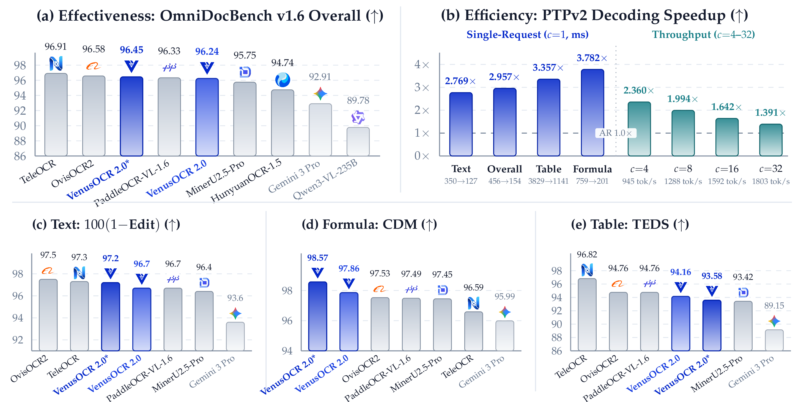
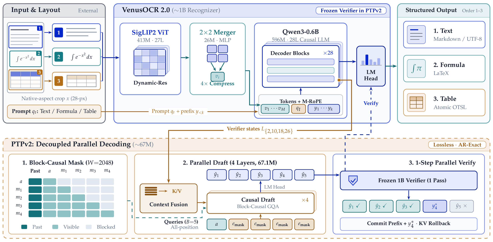

<div align="center">

#  VenusOCR 2.0

### Towards Efficient and Effective Document Parsing

English | [简体中文](README_zh.md)

[](https://arxiv.org/pdf/2611.32617)
[](https://huggingface.co/flow3rdown/VenusOCR)

</div>

---

**VenusOCR 2.0** is a lightweight, high-throughput document parsing system built for **text, formulas, and tables**. It converts PDFs and document images into clean, structured Markdown with layout visualizations.

This repository provides the **VenusOCR 2.0 Inference SDK**, including document loading, layout detection, region recognition, reading-order recovery, and result export via **vLLM serving**, **CLI**, **Python API**, **concurrent directory batching**, and a **Gradio Web Demo**.

<div align="center">

</div>

## ✨ Key Features

- **Unified Parsing**: Accurately recognizes multi-column text, LaTeX mathematical formulas, and complex tables.
- **Decoupled Pipeline**: Runs PP-DocLayoutV3 locally for layout detection and reading order, while offloading region recognition to an OpenAI-compatible **vLLM** server for flexible single-GPU sharing or distributed scaling.
- **High-Throughput Batching**: Directory batch mode shares a single layout model across documents and streams pages concurrently with automatic progress and failure logging.
- **Optional PTPv2 Acceleration**: Supports parallel draft-and-verify decoding (PTPv2) for lossless acceleration on long formulas, tables, and batched workloads.

## 🏗️ Architecture

<div align="center">

</div>

```text
PDF / Image
  ├──▶ PP-DocLayoutV3 (Layout Detection & Reading Order)
  │      ├── Text / Formula / Table crops ──▶ VenusOCR vLLM Server (AR or optional PTPv2)
  │      └── Figure / Chart / Seal crops  ──▶ Exported to imgs/
  └──▶ Assembly ──▶ Multi-page Markdown + Layout Visualization PDF (+ optional per-page JSON)
```

> Note: Charts, seals, and ordinary figures are cropped and saved to `imgs/` and referenced directly in the output Markdown.

## 📦 Installation

### Prerequisites

- Linux, Python >= 3.10
- PyTorch matching your CUDA / driver environment

### Install SDK

Install from the repository root (includes the default Transformers layout backend and vLLM server support):

```bash
git clone https://github.com/VenusOCR/VenusOCR.git
cd VenusOCR
pip install -e '.[transformers,serve]'
venusocr --help
```

Optional extras:

```bash
pip install -e '.[transformers,demo]'  # Gradio Web UI
pip install -e '.[paddlex]'            # Optional PaddleX layout backend (requires matching PaddlePaddle)
pip install -e '.[all]'                # All optional dependencies
```

> **Dependency Note**: Inference extras pin `transformers==5.5.4` and `vllm==0.20.0` for compatibility. Layout detection and recognition serving can share a single GPU (`gpu:0`); two GPUs are not required.

## ⬇️ Download Models

The pipeline uses two checkpoints: the **VenusOCR 2.0 recognizer** and the **PP-DocLayoutV3 layout detector**:

```bash
pip install -U huggingface_hub

# 1. VenusOCR 2.0 recognition weights (replace with the public model repo ID if needed)
hf download VenusOCR/VenusOCR-2.0 --local-dir ./models/VenusOCR2-1B

# 2. PP-DocLayoutV3 layout weights (optional; auto-downloaded if --layout-model-dir is omitted)
hf download PaddlePaddle/PP-DocLayoutV3_safetensors --local-dir ./models/PP-DocLayoutV3
```

> For offline environments, pre-download both complete directories (preserving configuration files, tokenizers, and custom Python modules) and pass their local paths at runtime.

## 🚀 Quick Start

Running VenusOCR takes two steps: **start the recognition server**, then **parse documents**.

### 1. Start the Recognition Server

#### Standard Mode (AR)

Launch the OpenAI-compatible vLLM server in one terminal (no vLLM source patches required):

```bash
CUDA_VISIBLE_DEVICES=0 venusocr serve ./models/VenusOCR2-1B \
  --host 127.0.0.1 --port 8000 --max-num-batched-tokens 4096 -- \
  --max-model-len 10240 --max-num-seqs 8 --gpu-memory-utilization 0.60
```

Verify readiness in another terminal:

```bash
curl http://127.0.0.1:8000/health
curl http://127.0.0.1:8000/v1/models
```

- Flags before `--` are handled by `venusocr serve`; **flags after `--` are passed directly to `vllm serve`**.
- When sharing a single GPU with the layout detector, leave sufficient GPU memory headroom (e.g., `--gpu-memory-utilization 0.60`), or run layout detection on CPU with `--device cpu`.

#### Accelerated Mode (Optional PTPv2)

To enable PTPv2 parallel decoding, use the scripts bundled inside the model repository (recommended in a dedicated serving environment; patches `vllm==0.20.0` and supports `--reverse`):

```bash
cd ./models/VenusOCR2-1B
bash scripts/patch_vllm_v0_20_ptp2.sh
HOST=127.0.0.1 PORT=8000 bash scripts/vllm_serve_ptp2.sh
```

The SDK automatically discovers the served model name from `/v1/models`, so all client parsing commands stay the same.

---

### 2. Parse Documents via CLI

Parse a single image, multi-page PDF, or an entire directory recursively:

```bash
# Single image
venusocr parse image.png -o ./output \
  --server-url http://127.0.0.1:8000/v1 \
  --layout-model-dir ./models/PP-DocLayoutV3

# Multi-page PDF (and print Markdown to stdout)
venusocr parse paper.pdf -o ./output \
  --layout-model-dir ./models/PP-DocLayoutV3 \
  --stdout

# Batch-parse a directory (shared layout model with concurrent page batching)
venusocr parse ./documents/ -o ./output \
  --num-workers 4 \
  --layout-model-dir ./models/PP-DocLayoutV3
```

**Output structure:**

```text
output/
├── <document>/
│   ├── <document>.md            # Combined Markdown (tables embedded as HTML)
│   ├── <document>_layout.pdf    # Original pages overlaid with layout boxes
│   └── imgs/                    # Cropped figures/charts (created when present)
├── failed_files.txt             # Failed files list for batch runs (if any)
└── _DONE                        # Batch completion marker and summary statistics
```

> When files in the same directory share a filename stem (e.g., `sample.pdf` and `sample.png`), output subdirectories keep the extension (`sample.pdf/` and `sample.png/`) to prevent overwrites.

---

### 3. Python API

```python
import json
from pathlib import Path
from venusocr import VenusOCR

with VenusOCR(overrides={
    "engine.vl_rec_server_url": "http://127.0.0.1:8000/v1",
    "engine.layout_model_dir": "./models/PP-DocLayoutV3",
    "engine.device": "gpu:0",
}) as ocr:
    # 1. Parse a single document and save Markdown + layout PDF
    result = ocr.parse("paper.pdf")
    result.save("./output", ocr.config.output)
    print(result.markdown)

    # 2. Optionally export per-page structured JSON
    pages = [page.json for page in result.page_results]
    Path("./output/pages.json").write_text(
        json.dumps(pages, ensure_ascii=False, indent=2), encoding="utf-8"
    )

    # 3. Batch-parse a directory
    summary = ocr.parse_dir("./documents/", "./output", num_workers=4)
    print(summary)
```

---

### 4. Gradio Web Demo

Launch an interactive web UI to preview Markdown, layout boxes, and first-page JSON:

```bash
venusocr demo --host 127.0.0.1 --port 7860 \
  --server-url http://127.0.0.1:8000/v1 \
  --layout-model-dir ./models/PP-DocLayoutV3
```

Open `http://127.0.0.1:7860` in your browser. Pass `--share` to generate a public link (avoid `--share` when processing sensitive documents).

## ⚙️ Configuration & Common Options

Default settings are defined in [`venusocr/config.yaml`](venusocr/config.yaml) with three levels of precedence:
`package defaults` → `--config your.yaml` → CLI flags / `--set section.key value` / Python `overrides`

| Common Need | Option / Usage |
| --- | --- |
| Run layout detection on CPU | `--device cpu` (useful when GPU memory is tight or on CPU-only clients) |
| Auto-download layout model | Omit `--layout-model-dir` to download `PP-DocLayoutV3` automatically |
| Use PaddleX layout backend | `--layout-backend paddlex` (requires `venusocr[paddlex]` and PaddlePaddle) |
| Set server API key | `--set engine.vl_rec_api_key YOUR_KEY` |
| Tune request concurrency | `--max-concurrency 16` |
| Skip layout PDF for speed | `--no-layout-vis` |
| Recognize a pre-cropped image | `--set predict.use_layout_detection false --set predict.prompt_label table` (`text` / `formula` / `table`) |
| Prevent long-output truncation | Increase `--set predict.max_new_tokens 8192` within the server's `max-model-len` budget |

## 🙏 Acknowledgements

We thank the following open-source projects:

- [PP-DocLayoutV3](https://huggingface.co/PaddlePaddle/PP-DocLayoutV3) / [PaddleOCR](https://github.com/PaddlePaddle/PaddleOCR)
- [MinerU](https://github.com/opendatalab/MinerU)
- [vLLM](https://github.com/vllm-project/vllm)
- [OmniDocBench](https://github.com/opendatalab/OmniDocBench)

## 📜 License

The inference SDK in this repository is licensed under the [Apache License 2.0](LICENSE). See [THIRD_PARTY_NOTICES.md](THIRD_PARTY_NOTICES.md) for third-party attributions. Model weights are governed by their respective repository licenses.

## 📎 Citation

If you find VenusOCR 2.0 useful in your research or applications, please consider citing:

```bibtex
@article{ptp2026,
  title={Efficient Document Parsing via Parallel Token Prediction},
  author={Lei Li and Ze-Kai Zhao and Meng Li and Zhong Lun and Yihan Yuan and Xing-Jing Lu and Zheng Wei and Jiang Bian and Zang Li},
  journal={2026 IEEE/CVF Conference on Computer Vision and Pattern Recognition- FINDINGS Track (CVPRF)},
  year={2026},
  url={https://api.semanticscholar.org/CorpusID:286573231}
}
```

```bibtex
@misc{venusocr2026,
  title={VenusOCR 2.0: Towards Efficient and Effective Document Parsing},
  author={{VenusOCR Team}},
  year={2026},
  howpublished={\url{https://github.com/VenusOCR/VenusOCR}}
}
```
