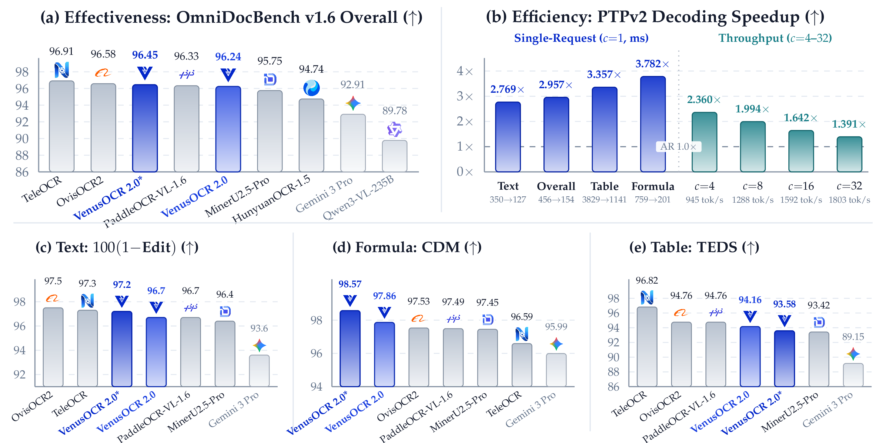
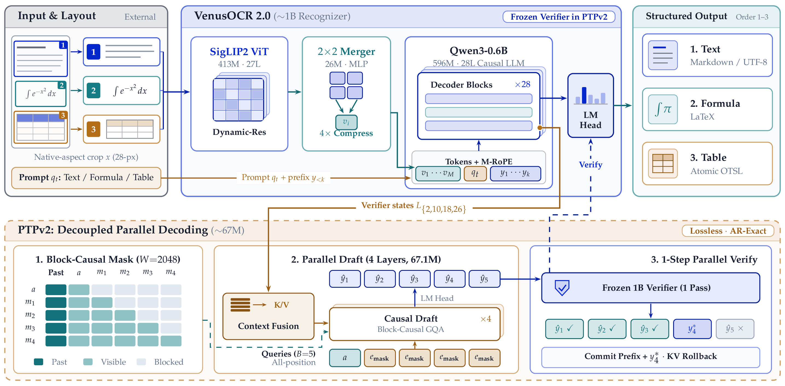

<div align="center">

#  VenusOCR 2.0

### Towards Efficient and Effective Document Parsing

[English](README.md) | 简体中文

[](https://arxiv.org/pdf/2611.32617)
[](https://huggingface.co/flow3rdown/VenusOCR)

</div>

---

**VenusOCR 2.0** 是一款轻量、高效的端到端文档解析系统，面向 **文本、公式与表格** 的结构化识别，可将 PDF 与文档图片直接转换为干净的 Markdown，并保留版面可视化结果。

本仓库提供完整的 **VenusOCR 2.0 推理 SDK**：涵盖文档加载、版面分析、区域识别、阅读顺序恢复与结果导出，支持 **vLLM 服务部署**、**命令行工具（CLI）**、**Python API**、**目录并发批处理** 及 **Gradio Web Demo**。

<div align="center">

</div>

## ✨ 核心特性

- **统一解析**：精准识别多栏排版正文、LaTeX 数学公式以及复杂表格。
- **解耦式流水线，灵活部署**：本地使用 PP-DocLayoutV3 完成版面检测与阅读顺序排序，识别阶段通过 OpenAI 兼容的 **vLLM** 服务运行，支持单卡共享或跨机独立扩缩容。
- **高吞吐目录批处理**：批量解析混合文档目录时共享同一版面模型，跨文档按页组批并发识别，自动记录统计信息与失败清单。
- **可选 PTPv2 加速解码**：支持并行草稿提议与主模型无损验证（PTPv2），显著降低长公式、长表格与批量推理延迟。

## 🏗️ 系统架构

<div align="center">

</div>

```text
PDF / 图片
  ├──▶ PP-DocLayoutV3（版面检测与阅读顺序排序）
  │      ├── 文本 / 公式 / 表格区域 ──▶ VenusOCR vLLM 服务（AR / 可选 PTPv2）
  │      └── 图片 / 图表 / 印章区域 ──▶ 裁剪并保存至 imgs/
  └──▶ 结果组装 ──▶ 跨页 Markdown + 版面可视化 PDF（+ 可选逐页 JSON）
```

> 注：图表、印章与普通插图区域会自动裁剪并保留在输出 `imgs/` 目录中，并在 Markdown 中正确引用。

## 📦 环境安装

### 基础要求

- Linux，Python >= 3.10
- 已安装与本机 CUDA / 驱动匹配的 PyTorch

### 安装步骤

从仓库根目录执行安装（默认包含 Transformers 版面后端与 vLLM 推理服务支持）：

```bash
git clone https://github.com/VenusOCR/VenusOCR.git
cd VenusOCR
pip install -e '.[transformers,serve]'
venusocr --help
```

按需安装其他扩展组件：

```bash
pip install -e '.[transformers,demo]'  # 包含 Gradio 可视化界面
pip install -e '.[paddlex]'            # 可选：PaddleX 版面后端（需另行安装匹配的 PaddlePaddle）
pip install -e '.[all]'                # 安装全部可选依赖
```

> **版本提示**：推理依赖已固定兼容版本（`transformers==5.5.4` 与 `vllm==0.20.0`），请保持默认依赖版本勿随意升级。若在同一张 GPU 上同时运行版面检测与识别服务，两者可共用 `gpu:0`，无需双卡。

## ⬇️ 下载模型

VenusOCR 解析流水线包含 **识别模型** 与 **版面检测模型** 两部分权重：

```bash
pip install -U huggingface_hub

# 1. 下载 VenusOCR 2.0 识别模型（请替换为实际公开模型仓库 ID）
hf download VenusOCR/VenusOCR-2.0 --local-dir ./models/VenusOCR2-1B

# 2. 下载 PP-DocLayoutV3 版面模型（可选，若省略 --layout-model-dir 首次运行时会自动下载）
hf download PaddlePaddle/PP-DocLayoutV3_safetensors --local-dir ./models/PP-DocLayoutV3
```

> 离线环境请提前完整下载上述两个目录（保留配置、Tokenizer 及自定义模块文件），并在运行时通过本地路径指定。

## 🚀 快速开始

使用过程分为两步：**先启动识别服务，再执行文档解析**。

### 1. 启动识别服务

#### 标准模式（AR）

在一个终端中启动 OpenAI 兼容的 vLLM 识别服务（无需修改 vLLM 源码）：

```bash
CUDA_VISIBLE_DEVICES=0 venusocr serve ./models/VenusOCR2-1B \
  --host 127.0.0.1 --port 8000 --max-num-batched-tokens 4096 -- \
  --max-model-len 10240 --max-num-seqs 8 --gpu-memory-utilization 0.60
```

在另一个终端确认服务已就绪：

```bash
curl http://127.0.0.1:8000/health
curl http://127.0.0.1:8000/v1/models
```

- `--` 之前的参数由 `venusocr serve` 解析，**`--` 之后的参数将直接透传给 `vllm serve`**。
- 单卡同时运行版面检测与识别服务时，请适当预留显存（如 `--gpu-memory-utilization 0.60`），或在解析端指定 `--device cpu` 运行版面检测。

#### 加速模式（可选 PTPv2）

如需启用 PTPv2 并行解码加速，请使用模型仓库内置的补丁与启动脚本（建议在独立服务环境操作，补丁仅针对 `vllm==0.20.0` 并支持 `--reverse` 还原）：

```bash
cd ./models/VenusOCR2-1B
bash scripts/patch_vllm_v0_20_ptp2.sh
HOST=127.0.0.1 PORT=8000 bash scripts/vllm_serve_ptp2.sh
```

SDK 会自动通过 `/v1/models` 发现服务端模型名，客户端解析命令无需任何改动。

---

### 2. 命令行解析（CLI）

支持单张图片、多页 PDF 以及整个文档目录的递归并发解析：

```bash
# 解析单张图片
venusocr parse image.png -o ./output \
  --server-url http://127.0.0.1:8000/v1 \
  --layout-model-dir ./models/PP-DocLayoutV3

# 解析多页 PDF（并在终端打印 Markdown）
venusocr parse paper.pdf -o ./output \
  --layout-model-dir ./models/PP-DocLayoutV3 \
  --stdout

# 批量解析整个目录（共享版面模型，并发组批推理）
venusocr parse ./documents/ -o ./output \
  --num-workers 4 \
  --layout-model-dir ./models/PP-DocLayoutV3
```

**输出目录结构：**

```text
output/
├── <文档名>/
│   ├── <文档名>.md            # 完整 Markdown（表格自动转为 HTML 嵌入）
│   ├── <文档名>_layout.pdf    # 原始页面叠加版面检测框的可视化 PDF
│   └── imgs/                  # 文档内图片/图表区域裁剪图（存在时生成）
├── failed_files.txt           # 批量任务失败清单（仅失败时生成）
└── _DONE                      # 批量任务完成标记及统计信息
```

> 若同一目录下存在同名不同后缀的文件（如 `sample.pdf` 与 `sample.png`），输出目录会自动保留扩展名（`sample.pdf/` 与 `sample.png/`）以防止结果覆盖。

---

### 3. Python API

```python
import json
from pathlib import Path
from venusocr import VenusOCR

with VenusOCR(overrides={
    "engine.vl_rec_server_url": "http://127.0.0.1:8000/v1",
    "engine.layout_model_dir": "./models/PP-DocLayoutV3",
    "engine.device": "gpu:0",
}) as ocr:
    # 1. 解析单个文档并保存 Markdown / 可视化 PDF
    result = ocr.parse("paper.pdf")
    result.save("./output", ocr.config.output)
    print(result.markdown)

    # 2. 按需导出逐页结构化 JSON
    pages = [page.json for page in result.page_results]
    Path("./output/pages.json").write_text(
        json.dumps(pages, ensure_ascii=False, indent=2), encoding="utf-8"
    )

    # 3. 批量解析目录
    summary = ocr.parse_dir("./documents/", "./output", num_workers=4)
    print(summary)
```

---

### 4. Gradio Web Demo

启动交互式网页界面，实时预览 Markdown、版面检测框以及第一页的结构化 JSON：

```bash
venusocr demo --host 127.0.0.1 --port 7860 \
  --server-url http://127.0.0.1:8000/v1 \
  --layout-model-dir ./models/PP-DocLayoutV3
```

启动后在浏览器访问 `http://127.0.0.1:7860`。如需生成公网分享链接可添加 `--share`（处理敏感文档时请勿开启）。

## ⚙️ 配置说明与常用选项

默认配置位于 [`venusocr/config.yaml`](venusocr/config.yaml)，支持三级覆盖（优先级由低到高）：
`包内默认配置` → `--config your.yaml` → CLI 快捷参数 / `--set section.key value` / Python `overrides`

| 常见需求 | 使用方式 / 参数 |
| --- | --- |
| 版面检测改用 CPU 运行 | `--device cpu`（显存紧张或纯 CPU 解析端适用） |
| 自动下载版面模型 | 省略 `--layout-model-dir`，首次运行自动拉取 `PP-DocLayoutV3` |
| 切换 PaddleX 版面后端 | `--layout-backend paddlex`（需安装 `venusocr[paddlex]` 与 PaddlePaddle） |
| 配置服务端 API Key | `--set engine.vl_rec_api_key YOUR_KEY` |
| 调整识别请求并发度 | `--max-concurrency 16`（根据服务端吞吐与显存调节） |
| 仅导出 Markdown（提速） | `--no-layout-vis`（跳过生成 `_layout.pdf`） |
| 仅识别已裁剪的单个区域 | `--set predict.use_layout_detection false --set predict.prompt_label table`（可选 `text` / `formula` / `table`） |
| 避免长内容输出被截断 | 增大 `--set predict.max_new_tokens 8192`（需同时满足服务端 `max-model-len` 上限） |

## 🙏 致谢

感谢以下开源项目：

- [PP-DocLayoutV3](https://huggingface.co/PaddlePaddle/PP-DocLayoutV3) / [PaddleOCR](https://github.com/PaddlePaddle/PaddleOCR)
- [MinerU](https://github.com/opendatalab/MinerU)
- [vLLM](https://github.com/vllm-project/vllm)
- [OmniDocBench](https://github.com/opendatalab/OmniDocBench)

## 📜 License

本仓库推理 SDK 代码基于 [Apache License 2.0](LICENSE) 开源；第三方组件来源与修改说明详见 [THIRD_PARTY_NOTICES.md](THIRD_PARTY_NOTICES.md)。模型权重的使用请遵循对应模型仓库中的许可协议。

## 📎 引用

如果 VenusOCR 2.0 对您的研究或工程项目有所帮助，欢迎引用：

```bibtex
@article{ptp2026,
  title={Efficient Document Parsing via Parallel Token Prediction},
  author={Lei Li and Ze-Kai Zhao and Meng Li and Zhong Lun and Yihan Yuan and Xing-Jing Lu and Zheng Wei and Jiang Bian and Zang Li},
  journal={2026 IEEE/CVF Conference on Computer Vision and Pattern Recognition- FINDINGS Track (CVPRF)},
  year={2026},
  url={https://api.semanticscholar.org/CorpusID:286573231}
}
```

```bibtex
@misc{venusocr2026,
  title={VenusOCR2.0: Towards Efficient and Effective Document Parsing},
  author={Lei Li and Zheng Wei and Yi Yuan and Qingbin Liu and Jiang Bian and Zang Li},
  year={2026},
  eprint={2611.32617},
  archivePrefix={arXiv},
  primaryClass={cs.CV},
  url={https://arxiv.org/abs/2611.32617},
}
```
